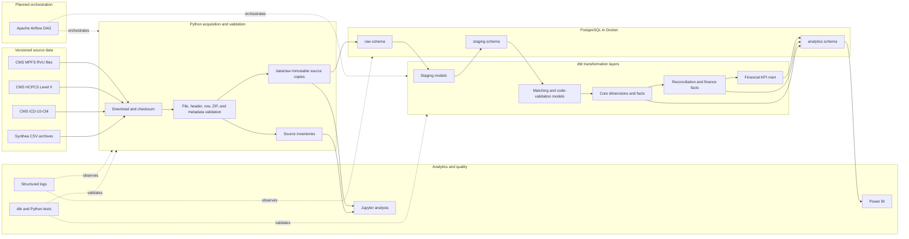

# System Architecture Overview

## 1. Purpose

The system provides a reproducible local data platform for acquiring synthetic
healthcare data and public CMS references, validating them, loading PostgreSQL,
transforming data with dbt, reconciling revenue-cycle records, and serving
documented analytical outputs.

This is the initial logical architecture. Components beyond Day 5 remain planned
until their implementation and tests are completed.

## 2. Logical architecture

## 3. Component responsibilities

| Component | Responsibility | Current status |
| --- | --- | --- |
| Synthea acquisition | Download pinned official sample, preserve selected CSVs, validate structure, and inventory hashes and counts. | Implemented and tested. |
| CMS acquisition | Download pinned ICD-10-CM, HCPCS, and MPFS archives; validate checksum, CRC, members, and effective version. | Implemented and tested. |
| Raw filesystem | Retain byte-preserved source data and tracked inventories. | Implemented for selected sources. |
| PostgreSQL | Provide isolated `raw`, `staging`, and `analytics` schemas with environment-driven connectivity. | Implemented and connectivity-tested. |
| Raw database layer | Store source-aligned records with load metadata and minimal interpretation. | Planned. |
| dbt staging | Standardize names, types, dates, numeric values, null handling, and source metadata. | Planned. |
| dbt intermediate | Resolve identifier-based relationships and effective-date code validation. | Planned. |
| dbt core | Publish conformed dimensions and encounter, claim, and transaction facts. | Planned. |
| Reconciliation and finance | Publish exceptions, A/R, aging, denials, underpayment candidates, and leakage categories under approved rules. | Planned. |
| Airflow | Schedule acquisition, load, dbt, validation, and publication dependencies. | Planned. |
| Power BI | Present KPIs and drill-through exception detail from analytics models. | Planned. |
| Jupyter | Profile source structures and support controlled exploratory analysis. | Initial CMS exploration implemented. |

## 4. Data-layer principles

### Raw filesystem

- Source files remain unchanged and version-pinned.
- Large raw data files are ignored by Git; tracked inventories preserve source
  URL, version, checksum, size, member list, row counts where applicable, and
  timestamps.
- A new upstream version requires an explicit source-specification change and
  validation; mutable `latest` endpoints are avoided.

### PostgreSQL raw schema

- Source-aligned columns and records are retained.
- Load metadata should include source filename, source version, checksum, load
  identifier, and load timestamp.
- Rejects must retain the original record and a reason outside the accepted
  table rather than disappearing.

### Staging schema

- Column names become consistent snake case.
- Dates, timestamps, identifiers, numeric values, and nulls are parsed and
  tested.
- Staging does not apply financial conclusions or collapse unmatched records.

### Analytics schema

- Intermediate models own match and validation results.
- Core models own conformed dimensions and business facts.
- Reconciliation and finance models own approved exception and amount logic.
- KPI marts aggregate only from tested facts and expose refresh and rule
  versions.

## 5. Relationship and reconciliation boundaries

- Patient, encounter, claim, and transaction relationships use source
  identifiers and documented cardinalities.
- Amount equality is not a primary match key.
- Code validation requires code-system and effective-version awareness; unknown
  systems remain unknown rather than invalid.
- Financial reconciliation preserves source signs and transaction grain before
  applying approved classification rules.
- CMS MPFS data is a Medicare reference and cannot automatically determine
  contractual underpayment.

## 6. Security and operational controls

- Database credentials are supplied through environment variables and excluded
  from Git.
- Logs must not expose credentials or protected data.
- Database loads use transactions where partial state would be inconsistent.
- Pipelines fail on missing required files, checksum changes, structural
  mismatches, or failed critical tests.
- Large sources are processed with streaming, chunking, or database-native
  operations rather than unnecessary full-memory loads.
- Published outputs depend on successful source, relationship, amount, and
  reconciliation controls.

## 7. Initial deployment model

The initial deployment is local and containerized:

- Docker Compose runs PostgreSQL 16.
- Python scripts run from the project environment.
- dbt Core and Airflow will connect through environment-driven configuration.
- Power BI will consume approved PostgreSQL analytics models.

Production hosting, secret management, backup, recovery, monitoring, access
control, and service-level objectives are not yet selected and remain out of the
current scope.
